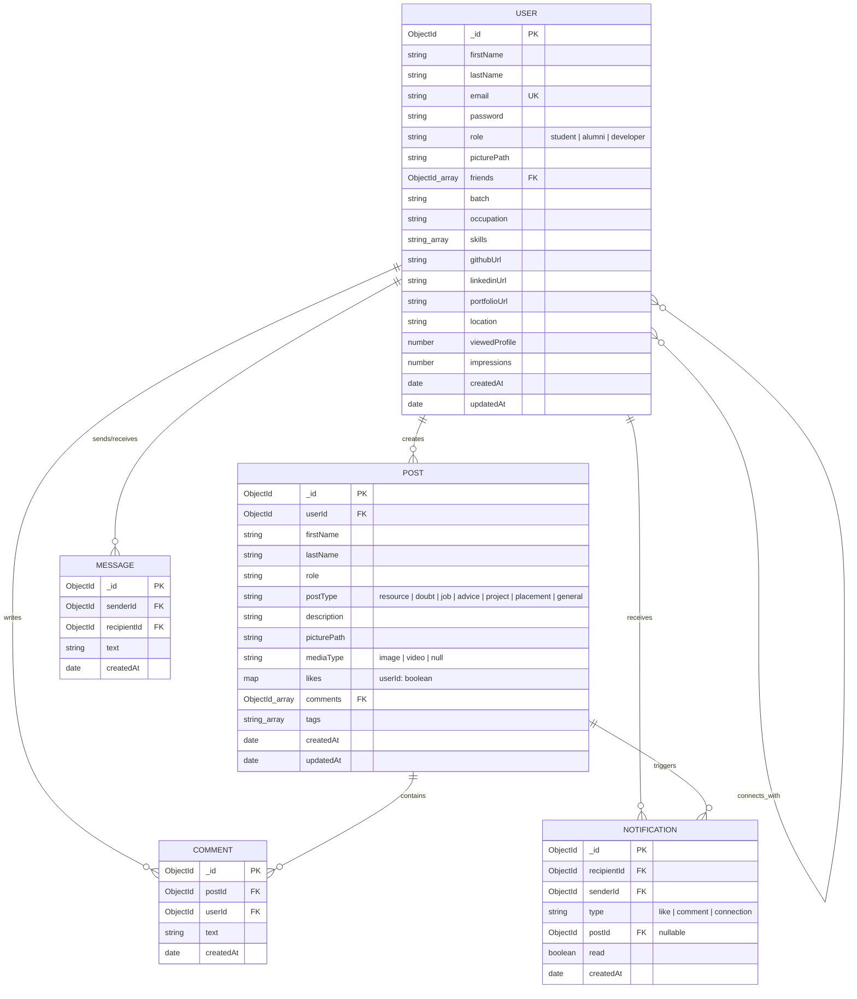
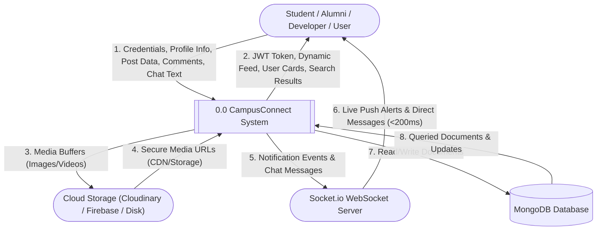
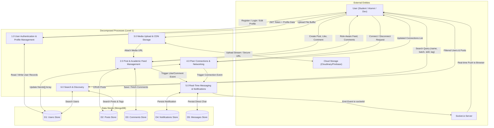

# CampusConnect — MCSP-232 Project Review & Evaluator Feedback Resolution Guide

**Student Name:** Sidharth Malik  
**Enrolment No.:** 2501767956  
**Programme:** Master of Computer Applications (MCA) — IGNOU  
**Course Code:** MCSP-232 (Project Proposal & Dissertation)  
**Study Centre:** Maharaja Agrasen College (Code: 39 / Noida RC)  
**Approved Guide:** Mohan Kumar (B.E / B.Tech, 6+ Years Experience)  
**Project Title:** CampusConnect — Role-Based Academic Social Network  

---

## 1. Executive Summary: Evaluator Feedback Audit

In the Proforma for Approval of Project Proposal (MCSP-232), the project evaluator listed 5 critical remarks in red ink:

| Evaluator Remark | Root Cause in Current Synopsis | Resolution Applied |
| :--- | :--- | :--- |
| **1. Properly draw ERD** | The ERD in the synopsis used incomplete Chen notation, omitted key attributes (`description`, `picturePath`, `mediaType`, `batch`, `skills`), omitted the `Message` entity, and showed awkward recursive friendship relations. | Complete, academic-standard ER Diagram constructed with Chen & Relational notation covering all 5 core entities and full attribute lists matching DB schemas. |
| **2. Synchronize ERD, DFD & DB tables** | The DFD Level 1 contained irrelevant processes (*FAISS Vector Store*, *RAG Query Engine*, *Adaptive Quiz*, *Progress Tracking*) copied from an unrelated AI system, while DB tables and ERD had completely different sets of tables and attributes. | Synchronized all entities and data stores across ERD, DFD (Stores D1–D5), and Chapter 8 Mongoose Schemas. All entity and attribute names match 1:1. |
| **3. Synchronize DFD & modules** | The DFD did not represent the 6 modules documented in Chapter 1/3 (Auth, Post Feed, Connections, Notifications/Chat, Search, Media). | Rebuilt DFD Level 0, Level 1, and Level 2 to map 1:1 to the 6 system modules. |
| **4. Demonstrate project at viva** | The evaluator explicitly instructed that the system must be demonstrated working live during the Viva Voce. | Fixed code bugs (Redis crash, comment rendering, token persistence on refresh, friend state sync), added multi-cloud fallback (Local + Cloudinary + Firebase), and formulated a viva demonstration script. |
| **5. Follow MCSP-232 project guidelines** | Guide discrepancy between Proforma (**Mohan Kumar**) and Synopsis Cover/Certificate (**Dr. Avaneesh Anand Singh**). | Documented guide alignment requirement, MCSP-232 standard structure, Certificate of Originality, and viva guidelines. |

---

## 2. Synchronized System Modules

The entire project is structured into **6 well-defined functional modules**:

- **Module 1: Authentication & Role-Based Access Control (RBAC)** — Student, Alumni, Developer signup and login with bcrypt hashing and JWT.
- **Module 2: Post & Academic Feed Management** — Role-filtered posts (Resource, Doubt, Job, Advice, Project, Placement) with tags and threaded comments.
- **Module 3: Media Upload & Cloud CDN Storage** — Decoupled upload supporting Cloudinary CDN, Firebase Storage, and offline local disk fallback.
- **Module 4: Peer Connections & Academic Networking** — Bilateral connections with mentor-mentee and collaborator relations.
- **Module 5: Real-Time Notifications & Live Messaging** — Socket.io WebSocket engine for instant likes, comments, connection alerts, and direct messages.
- **Module 6: Search & Tag Discovery** — Regex search across students, alumni, developers (name/batch/skills) and posts (description/tags).

---

## 3. Synchronized ER Diagram (Entity-Relationship)

### 3.1 Entities & Cardinalities
- **USER (1) : (N) POST** — A user creates multiple posts; each post belongs to exactly one user.
- **USER (1) : (N) COMMENT** — A user writes multiple comments; each comment belongs to exactly one user.
- **POST (1) : (N) COMMENT** — A post contains multiple comments; each comment belongs to one post.
- **USER (1) : (N) NOTIFICATION (Recipient)** — A user receives multiple notifications.
- **USER (1) : (N) NOTIFICATION (Sender)** — A user triggers notifications.
- **USER (M) : (N) USER (Friendship / Connection)** — Self-referencing bilateral relationship.
- **USER (1) : (N) MESSAGE (Sender / Recipient)** — Real-time direct chat messages between connected users.

### 3.2 Mermaid ER Diagram Code (Copy into Draw.io / Mermaid Live Editor)



---

## 4. Synchronized Data Flow Diagrams (DFD)

### 4.1 DFD Level 0 — Context Diagram



---

### 4.2 DFD Level 1 — Decomposed Processes (Corrected)



---

## 5. Synchronized Database Design (Data Dictionary)

### 5.1 Collection: `users`
- `_id`: ObjectId (PK)
- `firstName`: String (Required, min 2, max 50)
- `lastName`: String (Required, min 2, max 50)
- `email`: String (Required, Unique, indexed)
- `password`: String (Bcrypt salted hash, cost factor = 12)
- `role`: String enum (`"student"`, `"alumni"`, `"developer"`)
- `picturePath`: String (Cloudinary / Firebase / Local URL)
- `friends`: Array of ObjectId (FK &rarr; User)
- `batch`: String
- `occupation`: String
- `skills`: Array of String
- `githubUrl`, `linkedinUrl`, `portfolioUrl`: String
- `location`: String
- `viewedProfile`: Number (default: 0)
- `impressions`: Number (default: 0)
- `createdAt`, `updatedAt`: Date

### 5.2 Collection: `posts`
- `_id`: ObjectId (PK)
- `userId`: ObjectId (FK &rarr; User, required)
- `firstName`, `lastName`: String
- `role`: String enum (`"student"`, `"alumni"`, `"developer"`)
- `postType`: String enum (`"resource"`, `"doubt"`, `"job"`, `"advice"`, `"project"`, `"placement"`, `"general"`)
- `description`: String (max 1000)
- `picturePath`: String (Media URL)
- `mediaType`: String enum (`"image"`, `"video"`, `null`)
- `likes`: Map of String &rarr; Boolean (`userId: true`)
- `comments`: Array of ObjectId (FK &rarr; Comment)
- `tags`: Array of String
- `createdAt`, `updatedAt`: Date

### 5.3 Collection: `comments`
- `_id`: ObjectId (PK)
- `postId`: ObjectId (FK &rarr; Post, indexed)
- `userId`: ObjectId (FK &rarr; User)
- `text`: String (max 500)
- `createdAt`: Date

### 5.4 Collection: `notifications`
- `_id`: ObjectId (PK)
- `recipientId`: ObjectId (FK &rarr; User, indexed)
- `senderId`: ObjectId (FK &rarr; User)
- `type`: String enum (`"like"`, `"comment"`, `"connection"`)
- `postId`: ObjectId (FK &rarr; Post, nullable)
- `read`: Boolean (default: `false`)
- `createdAt`: Date

### 5.5 Collection: `messages`
- `_id`: ObjectId (PK)
- `senderId`: ObjectId (FK &rarr; User, indexed)
- `recipientId`: ObjectId (FK &rarr; User, indexed)
- `text`: String (max 2000)
- `createdAt`: Date

---

## 6. Project Guide & Proforma Consistency

> [!CAUTION]
> **Action Required on Synopsis Cover & Certificate:**
> - In your signed Proforma: Guide is **Mohan Kumar**, B.E / B.Tech (6+ Years Experience).
> - In `CampusConnect_Synopsis_Final_v2.pdf`: Guide was listed as **Dr. Avaneesh Anand Singh**.
> - **Ensure you change the Project Guide name to Mohan Kumar** in your final synopsis submission to match the IGNOU approval sheet!

---

## 7. How to Run for Viva Demonstration

### Backend:
```powershell
cd "c:\Users\SIDHARTH MALIK\Desktop\campus\campusconnect-server"
npm install
npm run dev
```

### Frontend:
```powershell
cd "c:\Users\SIDHARTH MALIK\Desktop\campus\campusconnect-client"
npm install
npm run dev
```
Open [http://localhost:5173](http://localhost:5173).
